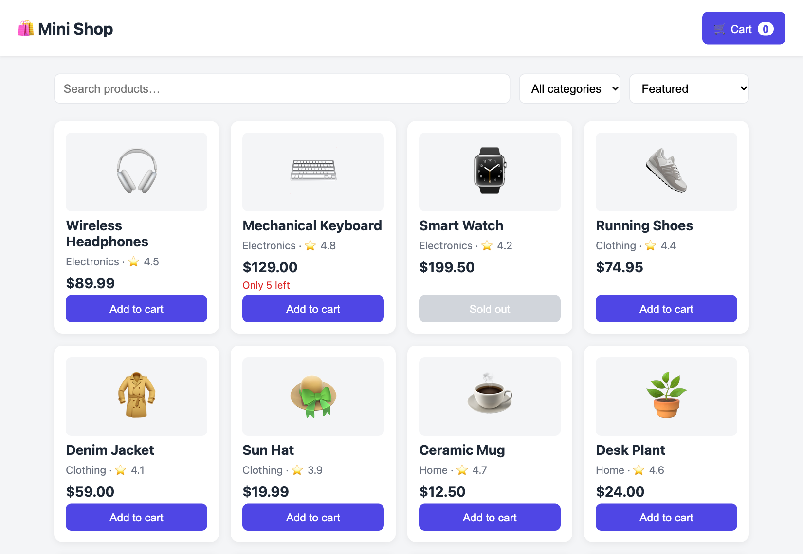
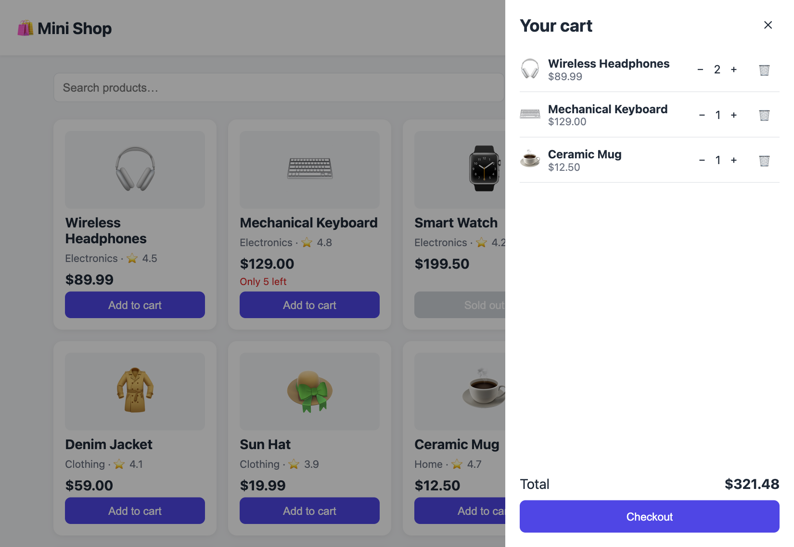

# web-interview

A small e-commerce example (React + Vite) used for code review practice. All data is mocked; no backend is needed.

## Features

- Product catalog with search, category filter and sorting
- Shopping cart (add / change quantity / remove), persisted to `localStorage`
- Stock limits (sold out, "only N left", max quantity in cart)
- Mock checkout with loading, success and error states

## Run

```
npm install
npm run dev
```

## Structure

```
src/
  api/products.js       mock product data + fake fetch/checkout (with latency)
  context/CartContext   cart state (useReducer + context)
  hooks/useProducts     loads the catalog
  components/           Header, Filters, ProductList, ProductCard, Cart
  utils/format.js       price formatting
```

## Screenshots




